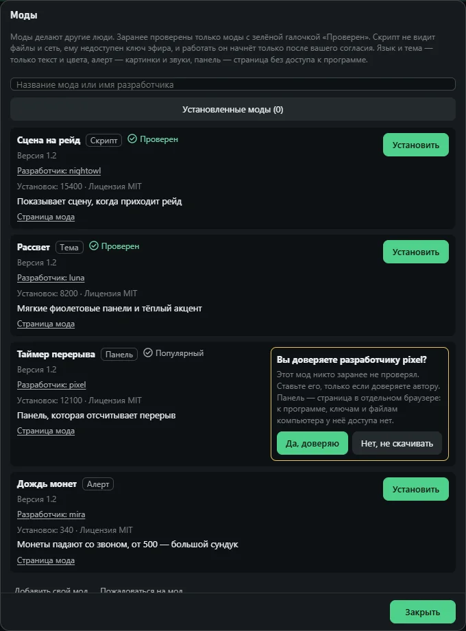
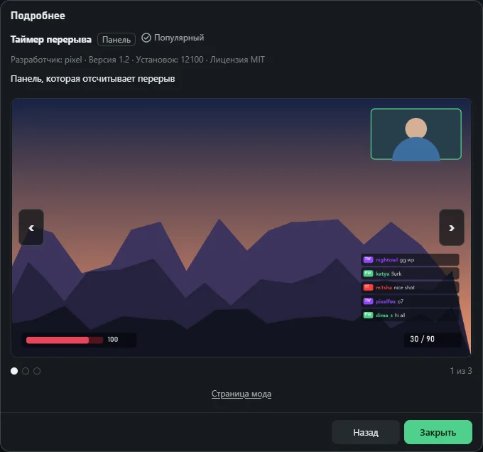
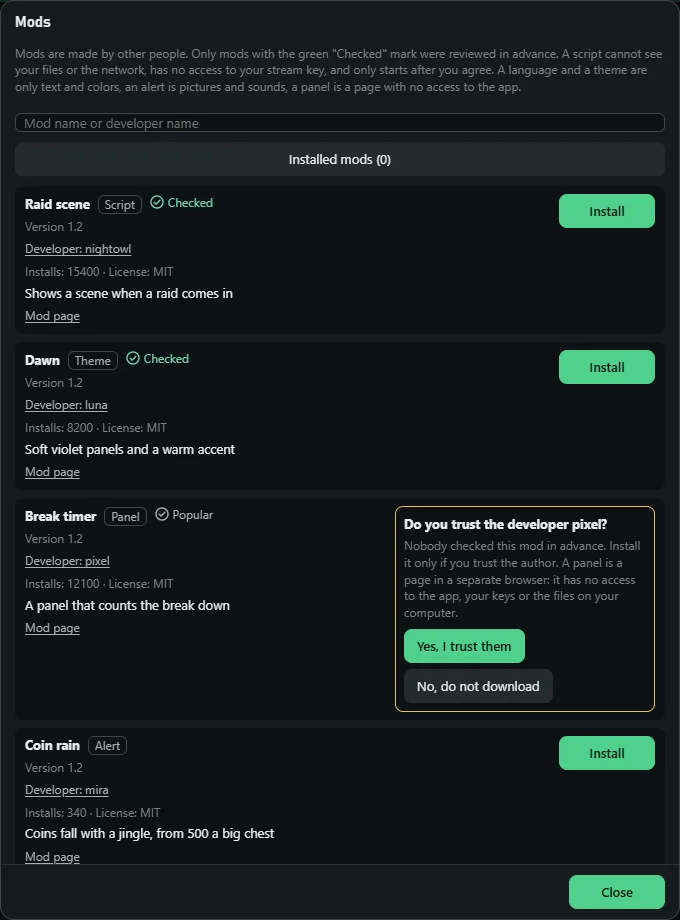
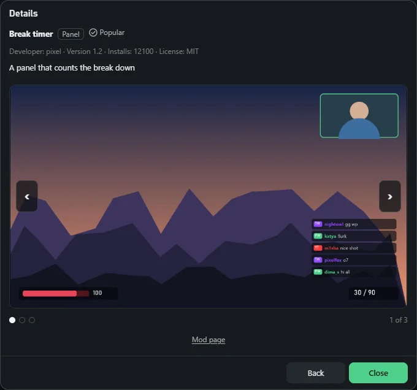

# Моды Efirra

Список модов для [Efirra](https://github.com/Baamich/Efirra-releases), программы для эфиров. В программе они открываются кнопкой **Моды**. [English below](#english)

Мод — это скрипт Lua, язык, тема, алерт или панель. Скрипт работает в песочнице: без файлов, сети и ключа эфира, и только после согласия человека. Панель — одна HTML-страница в отдельном браузере без доступа к программе и файлам компьютера. Другой код не принимаем: никаких DLL, EXE и VST.





Что делают модами:

- **Скрипты** — смена сцен по таймеру или по активному окну, тише музыка в разговоре, команды в чате: зритель пишет `!тг`, и скрипт отвечает ссылкой прямо в чат VK или Twitch.
- **Языки** — Efirra на вашем языке. Английский словарь для перевода лежит в программе: Справка → Документация → Папка с документацией, файл `en.json`.
- **Темы** — свои цвета для всей программы.
- **Алерты** — готовый алерт с картинками, роликами и звуками из конструктора алертов.
- **Панели** — маленькая страница рядом со сценами: счётчики, таймеры, заметки.

Полное руководство со всеми полями и примерами — в программе: Справка → Документация → **Моды**, а команды скриптов — в главе **Скрипты и виджеты**.

## Проверить мод до отправки

Чтобы пользоваться модом, этот репозиторий не нужен. В Efirra выберите **Моды → Установить из папки** и укажите папку с `mod.json` и главным файлом. Программа проверит мод теми же правилами, что и каталог, и поставит его только вам, с отметкой **Свой**. Поправили файлы — нажмите **Перечитать**. Папку можно передать другу: он поставит её так же.

## Как добавить мод

Проще всего — прямо из программы: **Моды → Мои моды → Войти через GitHub → Новый мод**. Efirra сама сделает копию репозитория в вашем GitHub и пришлёт pull request от вашего имени; там же мод можно изменить или убрать. Ник в каталоге — ваш логин GitHub.

Вручную: пришлите pull request с папкой на себя и папкой на каждый мод:

```
mods/
  ваше-имя/
    developer.json
    ваш-мод/
      mod.json
      main.lua        главный файл, один из:
                        main.lua            скрипт
                        main.json           язык
                        theme.json          тема
                        alert.efirra-alert  алерт (конструктор алертов → «Сохранить файлом»)
                        panel.html          панель
      README.md       по желанию
      LICENSE         по желанию
      screenshots/    по желанию: 1.png, 2.jpg, 3.webp…
```

Имена папок: строчные `a-z`, `0-9` и `-`, первой идёт буква. Имя разработчика показывается в программе, до 19 символов; имя мода — до 20.

`developer.json` — только ваш логин GitHub:

```json
{ "github": "ваш-логин-github" }
```

`mod.json`:

```json
{
  "kind": "script",
  "name": "Scene timer",
  "version": "1.0",
  "license": "MIT",
  "description": { "en": "Switches scenes on a timer", "ru": "Меняет сцены по таймеру" }
}
```

`kind` — `script`, `language`, `theme`, `alert` или `panel`. У языка ещё `"code": "de"`. При каждом изменении главного файла поднимайте `version`.

Тема — шесть цветов и скругление:

```json
{ "accent": "#ff9f5a", "controls": "#dfe6ff", "warm": "#ffd27a", "panels": "#141a33", "background": "#0a0e1f", "text": "#e6ebff", "radius": 12 }
```

Алерт делается в программе: конструктор алертов → **Сохранить файлом**. Внутри только картинки, ролики и звуки, до 20 МБ. Панель — одна HTML-страница до 1 МБ: в интернет она ходить может, как обычная страница, а до программы не дотянется.

Снимки показывают, что делает мод: положите их в папку `screenshots/` и назовите номерами — `1.png`, `2.jpg`, `3.webp`. Программа покажет их в окне **Подробнее** по возрастанию номера. До 8 снимков, PNG, JPEG или WebP, каждый до 2 МБ; проверка смотрит настоящий формат, а не только расширение. Скачиваются снимки, только когда человек открывает **Подробнее**.

Проверка `check` подскажет, что исправить. Когда она пройдена, заявка принимается сама и мод появляется в программе через несколько минут. Менять папку потом сможете только вы: она привязана к вашему логину GitHub. Заранее моды никто не читает, поэтому плохой мод убирается по жалобе.

## Правила

- Своя работа или та, которой можно делиться, с указанной лицензией.
- Без пиратства, контента для взрослых, вредоносного кода, нарушений закона и чужих логотипов без права на них.
- Скрипт делает то, что написано в описании.

За нарушение мод убирается из списка, а логин блокируется. Моды принадлежат авторам, у каждого своя лицензия.

В `mods/official/` лежат официальные моды Efirra. Эту папку меняет только владелец: заявка, которая её трогает, не проходит проверку, а в её `developer.json` может стоять только логин владельца. В программе у таких модов отметка **Официальный**, и они идут первыми.

## Галочки в программе

- **Зелёная, «Проверен»**: владелец Efirra просмотрел именно эту версию мода. Отметка привязана к файлу в `verified.json`, менять его может только владелец. Когда мод меняется, отметка пропадает до новой проверки.
- **Серая, «Популярный»**: больше 10 000 установок (счётчик скачиваний GitHub). Никто его не проверял.

Перед установкой программа всегда спрашивает, доверяет ли человек разработчику.

## Отозванные моды

Если мод оказался опасным, владелец его отзывает (`revoked.json`). Программа удаляет отозванный мод даже там, где он уже стоит.

## Пожаловаться на мод

В программе: **Моды → Пожаловаться**, выберите мод и напишите, что не так. Или [создайте issue](https://github.com/Baamich/Efirra-mods/issues/new/choose): какой мод и в чём проблема.

---

## English

The list of mods for [Efirra](https://github.com/Baamich/Efirra-releases), an app for live streams. The app shows them under the **Mods** button.

A mod is a Lua script, a language, a theme, an alert or a panel. Scripts run in a sandbox: no files, no network, no stream key, and only after the person agrees. A panel is one HTML page shown in a separate browser with no access to the app or the computer's files. Other code is not accepted: no DLL, EXE or VST.





What people make with mods:

- **Scripts** — scene switching on a timer or by the active window, quieter music in a talk scene, chat commands: a viewer writes `!tg` and the script answers with a link right in the VK or Twitch chat.
- **Languages** — Efirra in your language. The English dictionary to translate from is in the app: Help → Documentation → Documentation folder, file `en.json`.
- **Themes** — your colors for the whole app.
- **Alerts** — a ready alert with pictures, clips and sounds, made in the alert builder.
- **Panels** — a small page next to the scenes: counters, timers, notes.

The full guide with every field and example is in the app: Help → Documentation → **Mods**, and Help → Documentation → **Scripts and widgets** for the script API.

### Try your mod before sending it

You do not need this repository to use a mod. In Efirra choose **Mods → Install from a folder** and pick the folder with `mod.json` and the main file. The app checks it by the same rules as the catalog and installs it only for you, marked **Yours**. Changed the files? Press **Re-read**. You can also pass the folder to a friend: they install it the same way.

### Add your mod

The easiest way is right in the app: **Mods → My mods → Sign in with GitHub → New mod**. Efirra makes a copy of this repository in your GitHub and sends the pull request in your name; you can change or remove the mod there too. Your name in the catalog is your GitHub login.

By hand: send a pull request that adds one folder for you and one folder per mod:

```
mods/
  your-name/
    developer.json
    your-mod/
      mod.json
      main.lua        the main file, one of:
                        main.lua            a script
                        main.json           a language
                        theme.json          a theme
                        alert.efirra-alert  an alert (Save as a file in the alert builder)
                        panel.html          a panel
      README.md       optional
      LICENSE         optional
      screenshots/    optional: 1.png, 2.jpg, 3.webp…
```

Folder names: lowercase `a-z`, `0-9` and `-`, starting with a letter. `your-name` is shown in the app as the developer, up to 19 characters; `your-mod` up to 20.

`developer.json`:

```json
{ "github": "your-github-login" }
```

`mod.json`:

```json
{
  "kind": "script",
  "name": "Scene timer",
  "version": "1.0",
  "license": "MIT",
  "description": { "en": "Switches scenes on a timer", "ru": "Меняет сцены по таймеру" }
}
```

`kind` is `script`, `language`, `theme`, `alert` or `panel`. A language also has `"code": "de"`. Raise `version` whenever the main file changes.

A theme is six colors and a corner radius:

```json
{ "accent": "#ff9f5a", "controls": "#dfe6ff", "warm": "#ffd27a", "panels": "#141a33", "background": "#0a0e1f", "text": "#e6ebff", "radius": 12 }
```

An alert is made in the app: alert builder → **Save as a file**. Only pictures, clips and sounds go inside, up to 20 MB. A panel is one HTML page up to 1 MB; it may use the network like any web page, but it cannot reach the app.

Screenshots show what the mod does. Put them into `screenshots/` and name them by number: `1.png`, `2.jpg`, `3.webp`. The app shows them in **Details** from the smallest number up. Up to 8 pictures, PNG, JPEG or WebP, each up to 2 MB; the check looks at the real format, not only the extension. They download only when someone opens **Details**.

The `check` job tells you what to fix. Once it passes, your pull request is merged by itself and the mod appears in the app a few minutes later. Only you can change your folder afterwards: it is tied to your GitHub login. Nobody reads mods before they appear, so a report is how a bad one gets removed.

### Rules

- Your own work, or work you may share, with a license stated.
- No piracy, no adult content, no malware, nothing against the law, no logos you have no right to use.
- A script does what its description says.

Breaking these gets a mod removed and the login blocked. Mods belong to their authors, and each has its own license.

`mods/official/` holds official Efirra mods. Only the owner can change this folder: a pull request that touches it is refused, and its `developer.json` may name only the owner. In the app these mods are marked **Official** and listed first.

### Checks in the app

- **Green, "Checked"**: the owner of Efirra reviewed exactly this version of the mod. The mark is tied to the file in `verified.json`, which only the owner can change. When the mod changes, the mark goes away until the new version is reviewed.
- **Grey, "Popular"**: more than 10,000 installs (GitHub download count). Nobody reviewed it.

Before installing, the app always asks whether the person trusts the developer.

### Revoked mods

When a mod turns out to be dangerous, the owner revokes it (`revoked.json`). The app removes a revoked mod even where it is already installed.

### Report a mod

In the app: **Mods → Report**, pick the mod and write what is wrong. Or [open an issue](https://github.com/Baamich/Efirra-mods/issues/new/choose) and name the mod and the problem.
